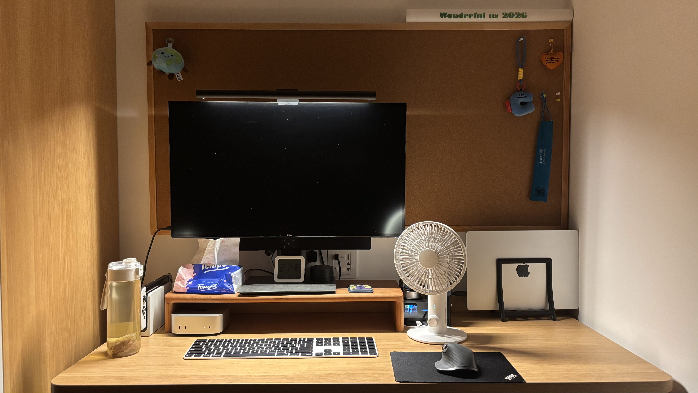
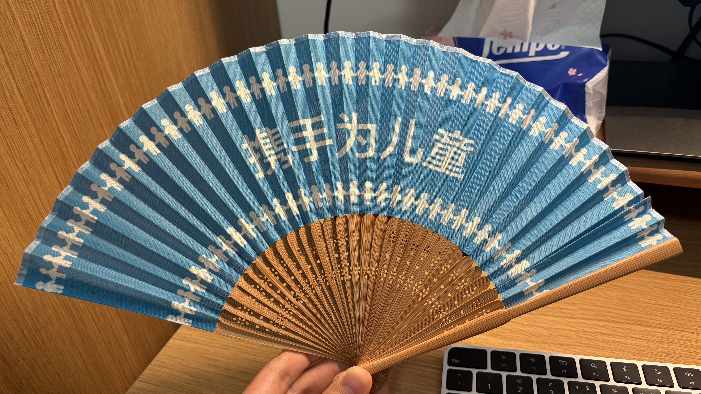

## About My Setup

My desk setup is relatively simple. I have a few UNNC i-week merch charms hanging on the corkboard above my desk.

In the upper-right corner is a cheering light stick from *Wonderful Us*, this year's UNNC Class Song Competition. In the lower-right corner is a fan I picked up last Saturday (October 25) at a UN briefing event hosted by Soochow University. When unfolded, it displays the slogan “Together for Every Child.” I really like UNICEF and this slogan, partly because I still consider myself a child. I deserve to celebrate Children's Day, right? So, if you're reading this, please remember to get me a gift next Children's Day. 😉

I'm a big fan of Nintendo, so there's a Switch OLED in the lower-left corner that's been with me for several years. Unfortunately, I've been far too busy lately to play much. I'm not really into mobile games; I much prefer games like *The Legend of Zelda*, *Stardew Valley*, and *Minecraft*.

My Mac mini serves as my home server, running several self-hosted services, including Vaultwarden and Immich.

I also have a Xiaomi temperature and humidity monitor, and the monitor light bar is from Xiaomi as well. My 27-inch Dell monitor has been serving me faithfully for several years, too. Since it doesn't have built-in speakers, I had to add an external one.

On the right side is a CUKTECH charging station that I bought shortly after the semester started. It's been quite handy, and I especially like its retractable charging cables. The fan is also from CUKTECH. LOL, I guess I'm a bit of a CUKTECH fan!

At the far right is an IKEA tissue holder that doubles as a monitor stand. It's surprisingly practical and cheap, and I've already bought several of them.

After trying different keyboards, I still think the Apple Magic Keyboard is hard to beat. Touch ID and USB-C charging make it pretty much perfect for my needs.

My mouse is the Logitech MX Master 3S. It's fantastic, and I'd highly recommend it!

I wonder how much my desk setup will change by the time I graduate. Lately, though, I've come to appreciate the idea of long-termism more and more. For me, a good desk setup is all about simplicity and durability: keeping things simple, choosing things that last, and making the most of what I have.

## 关于我的桌搭

我的桌面比较简单，软木板上挂了一些开学时领到的周边挂件。软木板右上角是今年 UNNC 班歌大赛 Wonderful Us 的应援棒，右下角是一个上周六（10月25号）去苏州大学参加联合国宣讲会时领到的一把扇子周边，展开是“携手为儿童”的标语，我很喜欢儿基会，也很喜欢这句标语，因为我觉得自己仍然是个儿童，我需要过儿童节，是的。如果你看到，请记得明年儿童节送我礼物😉。

我是老任的粉丝，所有左下角有一台服役了几年的 Switch OLED，但是最近实在是太忙了，没有时间玩游戏。我是一个几乎不玩手游的人，比较喜欢塞尔达、星露谷物语、我的世界这些游戏。

Mac Mini 是我的服务器，我在上面部署了一些 Vaultwarden, Immich 之类的服务。

有一个小米的温湿度计，屏幕挂灯也是小米的，显示器是 Dell，27寸，也已经服役好几年了，由于没有内置音响，所以需要额外加装一个。右边有一个酷态科的充电站，开学之后刚买的，我觉得还是挺方便的，比较喜欢抽拉充电线的设计。风扇也是酷态科的，我是酷态科的粉丝哈哈。

最右边是一个宜家的纸巾支架，用来当显示器支架非常方便，物美价廉，我已经买过好几个了。

键盘用来用去还是觉得 Magic Keyboard 好用啊，指纹解锁 + Type-C 充电，基本没毛病。

鼠标是 Logitech 的 MX Master 3S，非常好用，推荐！

不知道毕业的时候，我的桌面会有什么变化，但是我现在越来越认可长期主义，简单、耐用就是我的桌搭理念。
