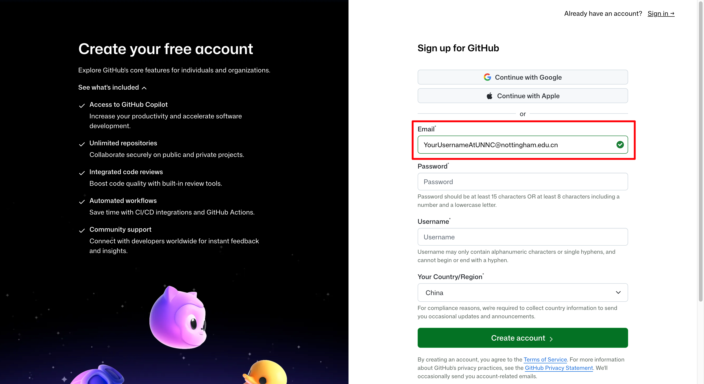
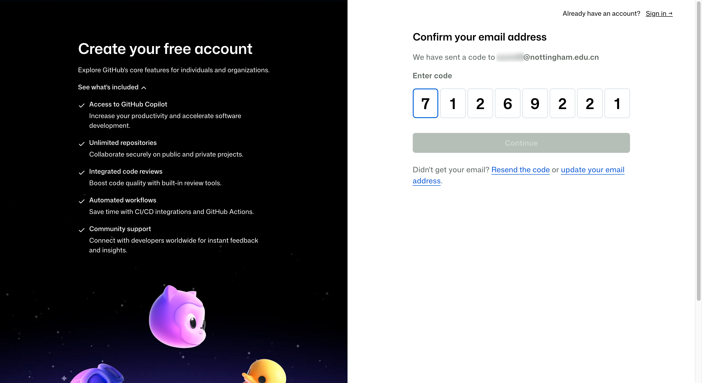
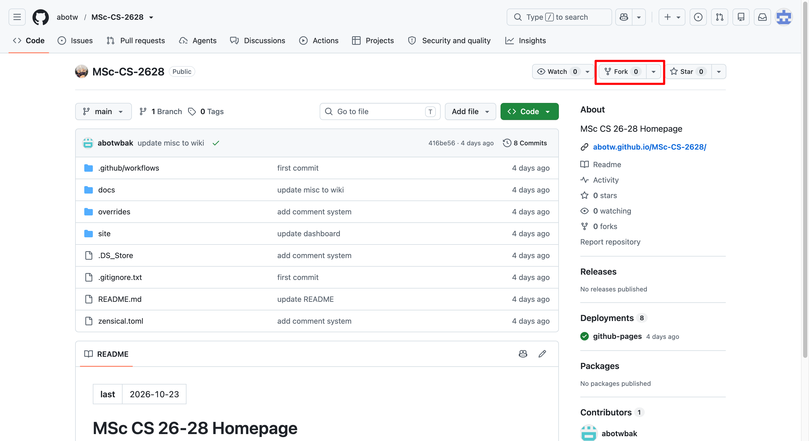
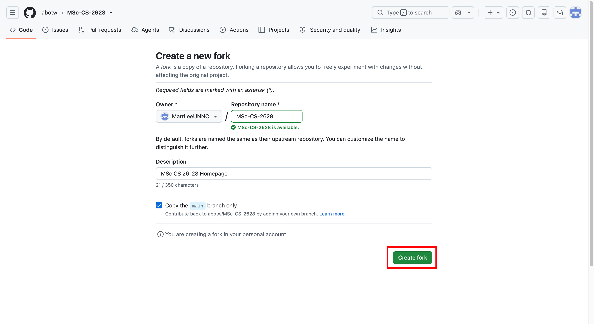
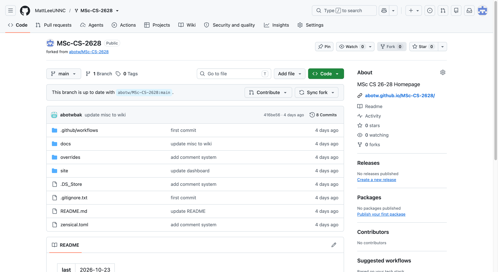
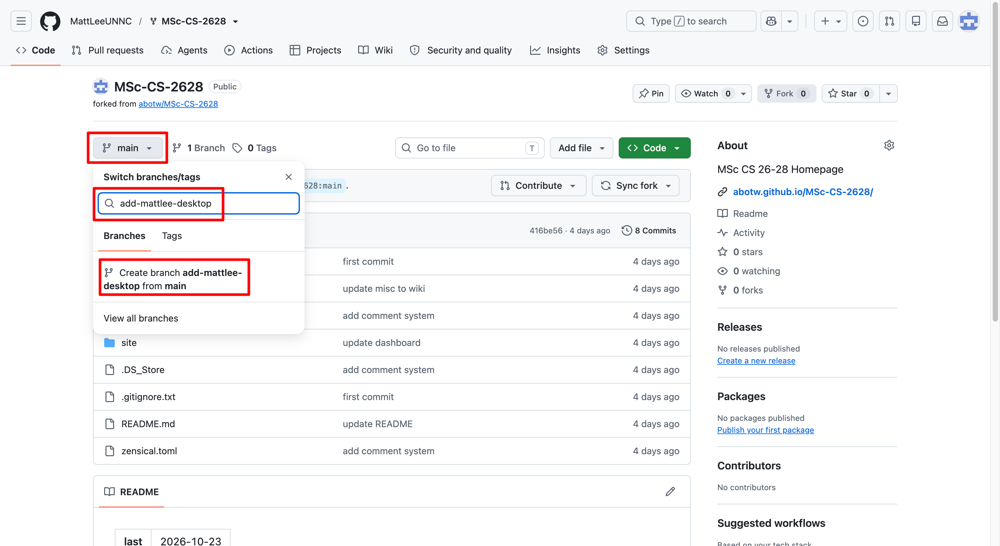
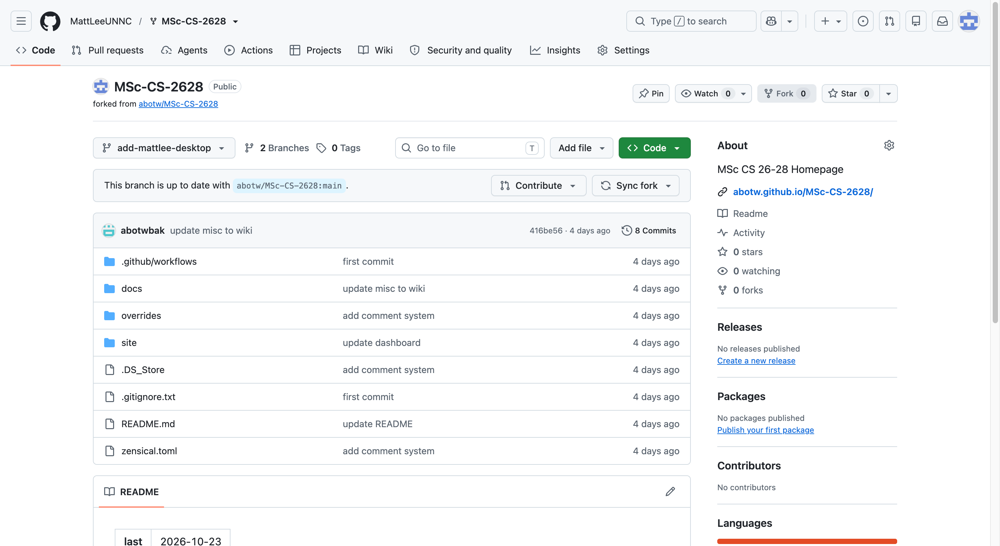

## One desktop, one story, one class memory

Welcome to our **Desktop Museum**!

Every student has a different workspace. Some of us have elaborate mechanical keyboard setups, some prefer a clean and minimal desk, and others surround themselves with favourite gadgets, plants, figures, or little reminders of home.

This activity is about collecting those personal details and preserving a snapshot of our time as UNNC Computer Science PGT students.

There's one extra challenge: **we'll build this collection together using GitHub!**

Never used Git? No problem. Never opened a terminal? That's fine, too. You don't need to know how to code to participate.

By the end of this activity, you'll have contributed to a real collaborative project, learned a little about how developers work together, and helped create a memory of our class.

## 1. The mission

Each student contributes one personal folder containing:

- A picture of their desktop setup.
    
- A Markdown file containing a short description and a few comments.
    

Our class repository is:

- **GitHub repository:** [MSc-CS-2628](https://github.com/abotw/MSc-CS-2628)
    
- **Class website:** [UNNC PGT Class Homepage](https://abotw.github.io/MSc-CS-2628/)
    
- **Contribution directory:** `docs/Activities/A01-DesktopMuseem/`
    

Your finished contribution will look like this:

```
A01-DesktopMuseem/
└── YourNameOrStudentID/
    ├── index.md
    └── desktop-yournameorstudentid.jpg (all in lowercase)
```

The folder name can be your real name or your student ID (if you don't want to publish you real name in the Internet). Please consider your privacy before using your real name or student ID in a public repository.

The workflow is simple:

1. Take a picture of your desktop.
    
2. Create your personal folder and Markdown file.
    
3. Upload your files to GitHub.
    
4. Submit a Pull Request.
    
5. Wait for your contribution to be reviewed and merged.
    
6. Find your contribution on our class website!
    

**Your job is to contribute your own folder, not to modify the website itself.**

## 2. A few GitHub concepts, explained simply

You don't need to memorise these definitions. They're here to make the following instructions easier to understand.

| Term              | In plain English                                                    |
| ----------------- | ------------------------------------------------------------------- |
| Repository        | The online project containing our class website and its files.      |
| Fork              | Your own copy of the class repository on GitHub.                    |
| Branch            | A separate workspace for preparing your changes.                    |
| Commit            | A saved set of changes.                                             |
| Push              | Uploading your saved changes from your computer to GitHub.          |
| Pull Request (PR) | A request asking the project owner to accept your changes.          |
| Merge             | Accepting your contribution into the main project.                  |
| Markdown          | A simple text format for headings, paragraphs, lists, and pictures. |

Think of the process like contributing to a shared scrapbook.

You make your own page, submit it for inclusion, and the organiser adds it to the main collection. Your original work stays separate until it is accepted.

## 3. Step 1 — Take your desktop picture

Your first task is the most enjoyable: show us your workspace!

You can photograph your physical desk or capture a screenshot of your digital desktop.

Ideas include:

- Your monitor, laptop, keyboard, mouse, and accessories.
    
- Your favourite wallpaper or desktop organisation.
    
- Your mechanical keyboard, keycaps, or mousepad.
    
- Plants, figures, collectibles, or other decorations.
    
- A minimalist workspace or a multi-monitor setup.
    
- A laptop-only setup that travels everywhere with you.
- And anything can show your personality.

### Image guidelines

1. Use good lighting if you're taking a photograph.
    
2. Make sure your main setup is visible.
    
3. **Save your picture as
	1. `desktop-yournameorstudentid.jpg`
	2. `desktop-yournameorstudentid.png`
	3. or `desktop-yournameorstudentid.webp`
    
4. Keep the image reasonably small so the website loads quickly. Around 1–3 MB is a sensible target.
    

### Please protect your privacy

Before uploading your picture, check that it doesn't reveal:

- Passwords, authentication codes, or account details.
    
- Private messages, emails, or personal documents.
    
- Confidential university materials or student records.
    
- Information about other people who have not agreed to be included.
    

Our repository is **PUBLIC**, so your contribution may be visible to anyone on the internet.

Participation should be voluntary. If you prefer not to share your real name, use an appropriate pseudonym instead. A student ID is not anonymous information, so don't assume it is a privacy-safe alternative.

## 4. Step 2 — Prepare your Markdown file

Next, create a file named `index.md` in your personal folder.

Markdown is just a text file with a few simple formatting symbols. You don't need special software to write it.

You can use VS Code, a plain-text editor, or any other editor that lets you save a file with the `.md` extension.

Copy this template:

```
---
title: "My Desktop Setup"
comments: "true"
created: 2026-10-27
---


## About My Setup

Describe your setup in a few sentences.

## My Favourite Things

- Keyboard:
- Mouse:
- Wallpaper:
- Favourite desk decoration:

## A Message to the Class

Write a short message, a funny story, or a memory
you would like your classmates to remember.
```

Replace the example prompts with your own content. Feel free to change the headings and remove any questions that don't apply to you.

You can write a little or a lot. A few genuine sentences are more than enough.

### A few questions to inspire you

- Why did you choose your current wallpaper?
    
- What's your favourite item on your desk?
    
- Is your setup designed for studying, gaming, creativity, or relaxation?
    
- What's one thing you couldn't study without?
    
- Does any item on your desk have a story behind it?
    
- What's one thing you would like to remember about your time at UNNC?
    

Your contribution doesn't need to be technical. A personal story can be just as interesting as a detailed hardware list.

### How does Markdown display a picture?

This line is important:

```

```

It tells the website to display the image file called `desktop-yournameorstudentid.jpg`.

Because the Markdown file and image are in the same folder, you only need to write the filename.

If your picture is named `desktop-mattlee.png`, use:

```

```

The filename must match exactly, including the extension and capitalisation.

## 5. Step 3 — Check your folder

Before uploading, make sure your files are organised like this:

```
YourNameOrStudentID/
├── index.md
└── desktop-yournameorstudentid.jpg
```

For example, if you choose the folder name `MattLee`:

```
A01-DesktopMuseem/
└── MattLee/
    ├── index.md
    └── desktop-mattlee.jpg
```

Your final folder name should be the identifier you choose, following the naming rules.

### Final checklist

- [ ] My folder has an appropriate name.
- [ ] My Markdown file is named `index.md`.
- [ ] My picture is inside the same folder.
- [ ] The image filename in Markdown matches the actual file.
- [ ] My comments are complete.
- [ ] I have checked the image for private information.
- [ ] I have not modified another student's contribution.

If everything looks good, it's time to submit your work!

## 6. Step 4 — Submit your contribution using GitHub

There are two recommended methods. **Method A is the easiest for beginners**, because you can do everything in your browser without installing Git or using the terminal.

### Method A — GitHub website (recommended for beginners)

You will use your browser to create a fork, upload your files, and open a Pull Request.

#### A1. Sign in to GitHub

Open the [MSc-CS-2628 repository](https://github.com/abotw/MSc-CS-2628).

Sign in to your GitHub account. If you don't have one, create an account at [github.com](https://github.com/).

**I suggest you create a brand-new account with your UNNC email address if you are a newbie.**





#### A2. Fork the repository

On the original repository page, click **Fork** near the top.





A fork is your personal copy of the class project. It lets you prepare changes without directly modifying the original repository.

Follow GitHub's prompts to create your fork.

You will now have a repository under your own GitHub username, with a name such as `MSc-CS-2628`.




#### A3. Create a branch

In your fork, open the branch selector, which normally shows `main`.

Create a new branch for your contribution. For example:

```
add-alice-desktop
```

Replace `alice` with your chosen identifier.



A branch is simply a separate place to prepare your work. You don't need to understand the underlying technical details to use it.



#### A4. Open the activity directory

In your fork, navigate to:

```
docs/Activities/A01-DesktopMuseem/
```

#### A5. Create your Markdown file

Inside `A01-DesktopMuseem/`, use **Add file → Create new file**.

In the filename field, enter your folder name and filename together. For example:

```
MattLee/index.md
```

GitHub will create the nested folder automatically when you commit the file.

Paste your completed Markdown content into the editor.

At the bottom of the page, enter a commit message:

```
add mattlee desktop contribution
```

Choose the option to commit directly to your new branch, then commit the file.

Your folder now exists in your fork.

#### A6. Upload your picture

Return to the directory you just created:

```
docs/Activities/A01-DesktopMuseem/MattLee/
```

Choose **Add file → Upload files**.

Upload your image, for example:

```
mattlee-desktop.jpg
```

Commit the upload to the same branch you used in the previous step.

Your folder should now contain:

```
MattLee/
├── index.md
└── desktop-mattlee.jpg
```

Replace `MattLee` with your own folder name.

#### A7. Create a Pull Request

Open your fork's main page. GitHub may display a **Compare & pull request** button after you push or commit a branch.

If you don't see it, open the **Pull requests** tab and select **New pull request**. Make sure you are comparing your branch against the original repository.

Check these settings carefully:

- **Base repository:** `abotw/MSc-CS-2628`
    
- **Base branch:** `main`
    
- **Head repository:** your fork
    
- **Compare branch:** your contribution branch
    

Your changes should go into the original class repository's `main` branch, not into another student's fork.

Give your Pull Request a descriptive title, such as:

```
add mattlee to the desktop museum
```

You can use this description:

```
I have added my desktop picture and comments.

Contribution folder:
docs/Activities/A01-DesktopMuseem/MattLee/
```

Click **Create pull request**.

Congratulations! Your contribution has been submitted.

The organiser can now review your changes and merge them into the class repository.

### Method B — GitHub Desktop (recommended if you want to learn Git)

If you prefer a desktop application, GitHub Desktop provides a graphical interface for working with Git.

Download it here:

[GitHub Desktop — Official Download](https://desktop.github.com/)

This method works on macOS and Windows.

#### B1. Install GitHub Desktop

Install the application and sign in with your GitHub account.

#### B2. Clone your fork

Open your fork on GitHub and use the option to open or clone it with GitHub Desktop.

Alternatively, select **File → Clone Repository** in GitHub Desktop and choose your fork.

Cloning downloads a copy of the repository to your computer.

#### B3. Create a branch

In GitHub Desktop, create a new branch, for example:

```
add-mattlee-desktop
```

Make sure you're working on this branch, rather than directly on `main`.

#### B4. Create your contribution folder

Open the local repository folder on your computer.

Navigate to:

```
docs/Activities/A01-DesktopMuseem/
```

Create your personal folder and put the two files inside it:

```
MattLee/
├── index.md
└── desktop-mattlee.jpg
```

You can create and edit these files with your usual file manager and text editor.

#### B5. Commit your changes

Return to GitHub Desktop.

Your new files should appear in the list of changes.

Enter a short summary, such as:

```
add mattlee desktop contribution
```

Click **Commit to add-mattlee-desktop** (the exact button text depends on your branch name).

This saves the changes locally.

#### B6. Push your branch

Click **Push origin** to upload your branch to your fork on GitHub.

Pushing uploads your changes but does not merge them into the original class repository.

#### B7. Open a Pull Request

Click **Create Pull Request** in GitHub Desktop, or open your fork on GitHub and create the PR there.

Check that the target repository is `abotw/MSc-CS-2628` and the base branch is `main`.

Submit your PR and wait for the organiser to review it.

## 7. Step 5 — Check your Pull Request

After submitting your PR, open it on GitHub and check the **Files changed** tab.

You should see your own two files:

```
docs/Activities/A01-DesktopMuseem/MattLee/index.md
docs/Activities/A01-DesktopMuseem/MattLee/mattlee-desktop.jpg
```

If you need to correct something, you can update the same branch. The existing Pull Request will include the new commit automatically.

You don't need to open another PR for each correction.

## 8. Step 6 — See your contribution on the class website

Once your PR is merged into the repository, your files become part of the original repository.

Zensical can then build the website, and GitHub Pages can publish the updated site.

The time required depends on the deployment workflow.

Visit the [class website](https://abotw.github.io/MSc-CS-2628/) after the deployment has completed.

When your contribution is published, check that the image and comments display correctly.

You've now contributed to a real collaborative project!

## 9. Troubleshooting

### My picture doesn't appear

Check that the image file is in the same folder as `index.md`.

If your file is called `desktop-mattlee.webp`, this link is incorrect:

```

```

Change it to:

```

```

Filenames are case-sensitive on many hosting systems, so `Desktop-mattlee.jpg` and `desktop-mattlee.jpg` may not be treated as the same file.

### I can't upload files

Check that you're signed in and that you're working in your fork.

If you are trying to upload directly to the original repository, you may not have write permission. **Fork the repository and use a Pull Request instead.**

### I don't see the Pull Request button

Open the **Pull requests** tab and choose **New pull request**.

Make sure your contribution branch has been committed and pushed to your fork. Then select the original repository as the base repository.

### I made a mistake

If your PR is still open, correct your files and commit the changes to the same branch.

If your PR has already been merged, you can submit another PR to correct your contribution.

### My PR was merged, but the website hasn't changed

The website may still be building or deploying. The organiser can inspect the repository's **Actions** tab to check the deployment status.

Also remember that a folder existing in GitHub doesn't necessarily mean it will be linked from the website's page.

### I'm still stuck

Ask the organiser or a classmate for help. You can also prepare your folder locally first and get assistance with the GitHub steps.

The goal is to learn together and create a shared memory, not to test your prior experience with Git.

## 10. Our ground rules

To keep the Desktop Museum welcoming and safe:

1. **One contribution per student.** Please avoid duplicate folders.
    
2. **Respect other people's work.** Only change your own contribution unless you have permission.
    
3. **Keep it appropriate.** Your picture and comments should be suitable for a class website.
    
4. **Protect your privacy.** Never upload passwords, private messages, confidential documents, or other sensitive information.
    
5. **Keep images lightweight.** Help us maintain a fast-loading website.
    
6. **Follow the naming rules.** Use an identifier approved for this activity.
    
7. **Participation is voluntary.** Don't share information or pictures you aren't comfortable publishing.
    
8. **Ask for help when needed.** Beginners are welcome.
    

Remember that removing a file later does not necessarily remove it from Git history, existing forks, or copies that others have downloaded. Think before you publish.

## 11. What have you learned?

Even though this activity doesn't require programming, you'll experience a real collaborative development workflow.

|Your action|What you've experienced|
|---|---|
|Create a folder and Markdown file|Organising a project|
|Fork the repository|Creating your own copy of a shared project|
|Create a branch|Isolating your work|
|Commit your changes|Saving a snapshot of your work|
|Push your branch|Uploading your changes|
|Open a Pull Request|Proposing a contribution|
|Review and merge changes|Collaborating on a shared project|
|See the website update|Publishing documentation|

These skills are useful even if you don't intend to become a software developer. They can help you contribute to documentation, group projects, open-source projects, and other collaborative work.

Most importantly, the Desktop Museum will preserve a little snapshot of who we were during our time at UNNC: our workspaces, our personalities, and our memories.

**Let's build our Desktop Museum — one folder, one picture, and one memory at a time.**
